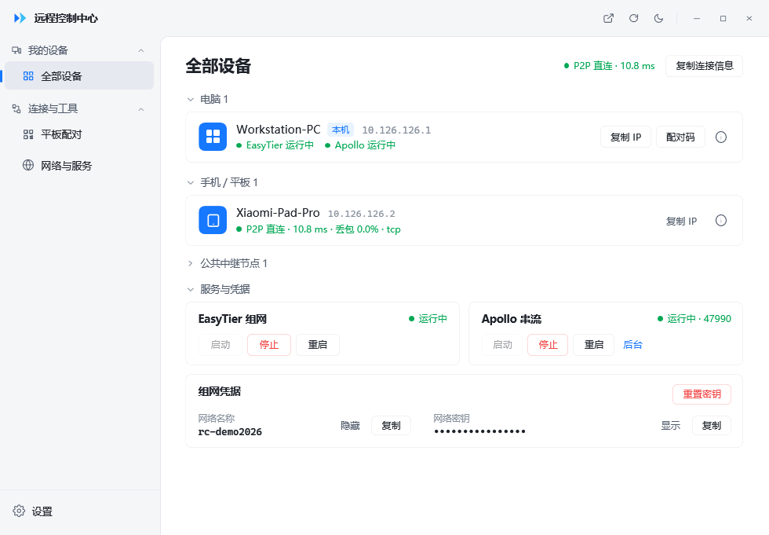
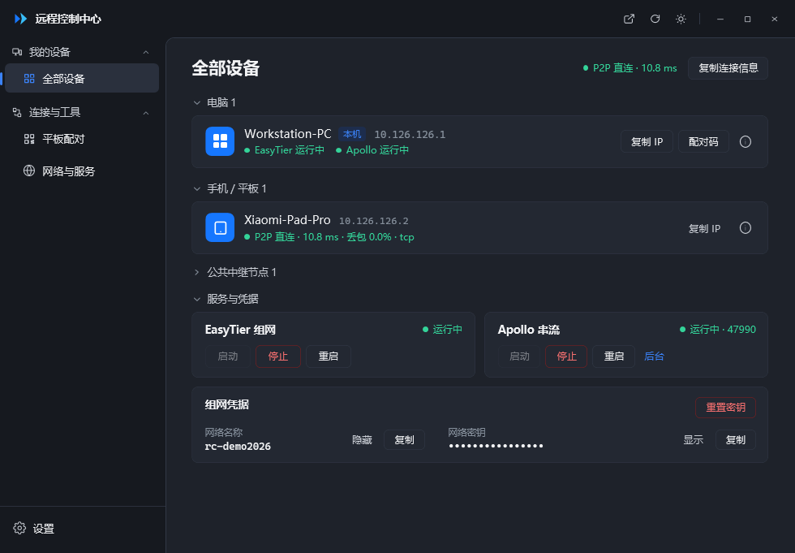
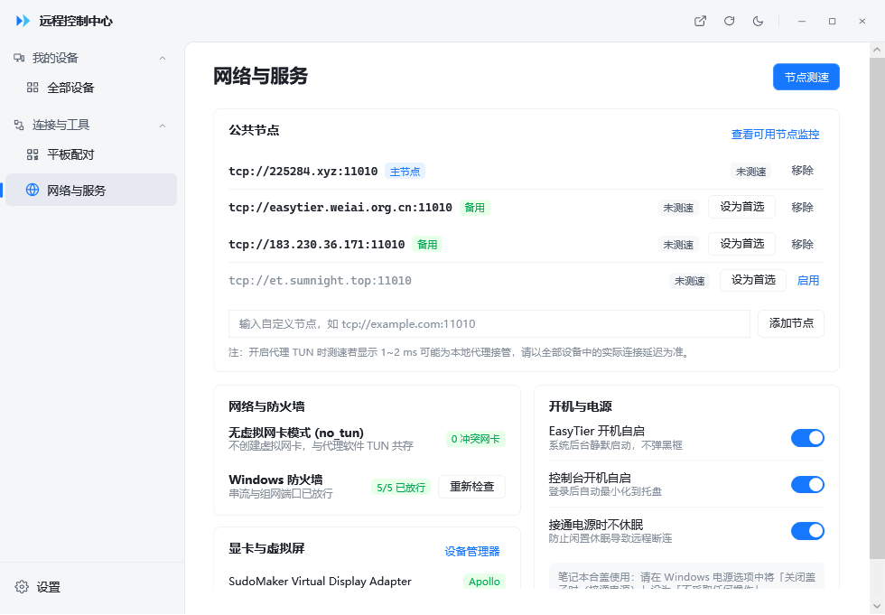
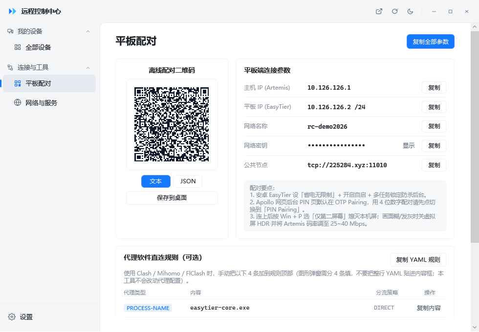

# Apollo-EasyTier-Remote（远程控制中心）

[](https://github.com/qianxuxuxu/Apollo-EasyTier-Remote/actions/workflows/ci-release.yml)
[](LICENSE)


基于 **Apollo（内置 SudoVDA 虚拟屏）+ Artemis + EasyTier（`no_tun = true` 无虚拟网卡模式）** 的免费、低延迟 Windows 远程控制与平板高刷串流方案，配套极简桌面控制台与一键自动部署脚本。

---

## 核心特性

- **零虚拟网卡冲突（`no_tun = true`）**：电脑端 EasyTier 不创建虚拟网卡，与 **Clash / Mihomo / FlClash / Anycast** 等代理软件 TUN 模式完美共存，且绝不改动任何代理配置文件。
- **自动虚拟屏 + 物理屏熄灭**：借助 Apollo 内置 `SudoVDA`，连接后自动生成匹配平板原生分辨率（如 2K 60fps/120fps）的虚拟屏幕；按 `Win + P` 选「仅第二屏幕」即可熄灭主机物理屏幕，断开后自动恢复。
- **极简桌面控制台（`RemoteControlUI.exe`）**：单文件 `.NET 4.8 WPF` 原生应用（~182 KB，零外部依赖），支持浅色/深色主题、系统托盘常驻、节点实时测速、离线配对二维码生成、防火墙体检与任务计划免 UAC 启动。
- **开箱即用 / 源码零环境编译**：仓库自带一键部署脚本 `一键下载与部署.bat`；无论从 Releases 下载打包版，还是直接 `git clone` / Download ZIP 源码，脚本均可利用系统自带 `.NET 4.8`（`csc.exe`）自动编译安装，无需安装 Visual Studio。
- **严格隐私与安全**：每次部署在本地使用密码学随机数现生成唯一 `network_name` 与 `network_secret`；代码库与发布包不含任何预设私钥或个人环境信息。

---

## 界面预览

| 全部设备（浅色） | 全部设备（深色） |
| :---: | :---: |
|  |  |

| 网络与服务 | 平板配对与代理规则 |
| :---: | :---: |
|  |  |

---

## 快速开始

### 方式 A：从 Releases 下载预编译工具包（推荐）

1. 前往本仓库 [**Releases 页面**](https://github.com/qianxuxuxu/Apollo-EasyTier-Remote/releases/latest) 下载 `Apollo-EasyTier-Remote-Toolkit-v*.zip` 并解压到本地目录（不要在压缩包内直接运行）。
2. 双击 **`一键下载与部署.bat`**：
   - 选 **`[1]`**：无需管理员权限，自动从上游官方 GitHub Releases 拉取最新版 Windows/Android 安装包（含平板端 **EasyTier APK** 与 **Artemis APK**）。
   - 选 **`[2]`**：自动提权并一键完成 EasyTier（`no_tun = true`）部署、本地随机密钥生成、Windows 防火墙 5 条规则放行、接电防休眠、开机静默计划任务注册及桌面快捷方式创建，末尾打开安全的 Apollo 图形安装向导。
   - 选 **`[3]`**：适合已装好 Apollo/EasyTier 的电脑，仅安装/升级新版桌面控制台。

### 方式 B：直接克隆或下载源码 ZIP

```powershell
git clone https://github.com/qianxuxuxu/Apollo-EasyTier-Remote.git
cd Apollo-EasyTier-Remote
.\一键下载与部署.bat
```

> 直接在源码目录运行 `一键下载与部署.bat` 时，若本地尚未编译 `.exe`，脚本会自动调用 Windows 内置的 `.NET 4.8 csc.exe` 在 2 秒内完成编译并部署；若在纯脚本环境缺失 `src/`，则自动从本仓库 Releases 拉取。

---

## 仓库目录结构

```text
Apollo-EasyTier-Remote/
├── .github/workflows/ci-release.yml  # GitHub Actions CI 自动编译、测试、脱敏检查与发版
├── docs/
│   ├── images/                       # 脱敏界面截图
│   └── 操作手册.md                   # 完整安装步骤、日常流程与避坑指南
├── scripts/
│   ├── build.ps1                     # 本地一键编译与运行单元测试脚本
│   └── deploy_remote.ps1             # 一键下载 / 全自动部署主脚本
├── src/                              # 桌面控制台 (RemoteControlUI) 与启动器 (Launcher) C# 源码
├── tests/                            # 单元测试 (UnitTests.cs) 与离线 QR / 二进制清白审计脚本
├── 一键下载与部署.bat                # 纯 ASCII 启动入口（防中文路径乱码）
├── 操作手册.txt                      # 随包附带的纯文本操作手册
└── LICENSE                           # MIT License
```

---

## 常见避坑汇总（实测踩坑整理）

完整图文步骤与细节请阅读 [**操作手册.md**](docs/操作手册.md)：

1. **代理软件图形弹窗加规则**：Clash / Mihomo / FlClash 图形弹窗有独立的「类型 / 内容 / 策略」下拉框，不要在类型选 `DOMAIN` 时粘贴整行 `IP-CIDR,...`，需拆成 4 条添加（`easytier-core.exe`、`10.126.126.0/24`、`apollo.exe`、`sunshine.exe`）。
2. **安装 Apollo 不要用 `/S` 静默参数**：`/S` 会连带静默安装 `ViGEmBus` 并触发 Windows PnP 驱动重启锁，容易导致代理软件 Wintun 虚拟网卡短时异常。走正常安装向导即可，不用手柄可取消勾选 `ViGEmBus`。
3. **旧官方节点停服与黑框弹窗**：`public.easytier.top:11010` 已停服；开着代理 TUN 时对不通 IP 测 TCP 延迟可能出现 `1~2 ms` 假通。本工具默认内置实测可用的社区节点，并通过计划任务加 `--console-log-level warn` 后台静默启动。
4. **Apollo 网页配对标签页**：`https://localhost:47990` 的 `PIN` 页面默认停在 `OTP Pairing`（且二维码默认地址为 `art://0.0.0.0:47989`）。用平板 Artemis 弹出的 4 位 PIN 码配对时，请点旁边的 **`PIN Pairing`** 标签再输入。
5. **画质模糊与 HDR 发灰**：Artemis 默认码率仅 `10 Mbps`、Apollo 默认 NVENC 预设 `P1` 且虚拟屏可能自动开 HDR。建议平板码率调至 `25~40 Mbps`（同 Wi-Fi 开 `40~80 Mbps`）、Apollo `nvenc_preset` 设为 `P4/P5`、并在 Windows 显示设置关闭虚拟屏 HDR。
6. **笔记本合盖 & 杀毒软件误报**：笔记本合盖远程使用需在电源选项将「关闭盖子时（接通电源）」设为「不采取任何操作」；本地无签名编译产物若被火绒/360 拦截，请将安装目录加入信任区。

---

## 手动从源码编译与测试

在任意 Windows 10 / 11 电脑上（无需安装 Visual Studio）：

```powershell
powershell -NoProfile -ExecutionPolicy Bypass -File .\scripts\build.ps1
```

## 上游项目致谢

- [ClassicOldSong/Apollo](https://github.com/ClassicOldSong/Apollo)（流媒体服务端与 SudoVDA 虚拟显示器）
- [ClassicOldSong/moonlight-android](https://github.com/ClassicOldSong/moonlight-android)（Artemis 安卓客户端）
- [EasyTier/EasyTier](https://github.com/EasyTier/EasyTier)（去中心化 P2P 虚拟组网核心）
